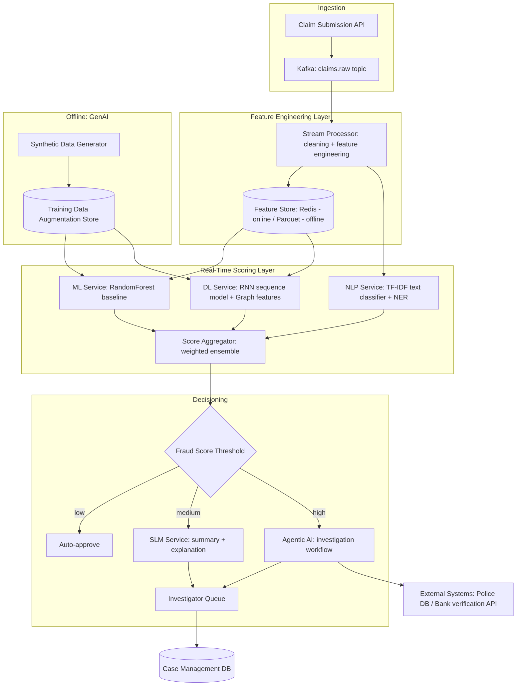
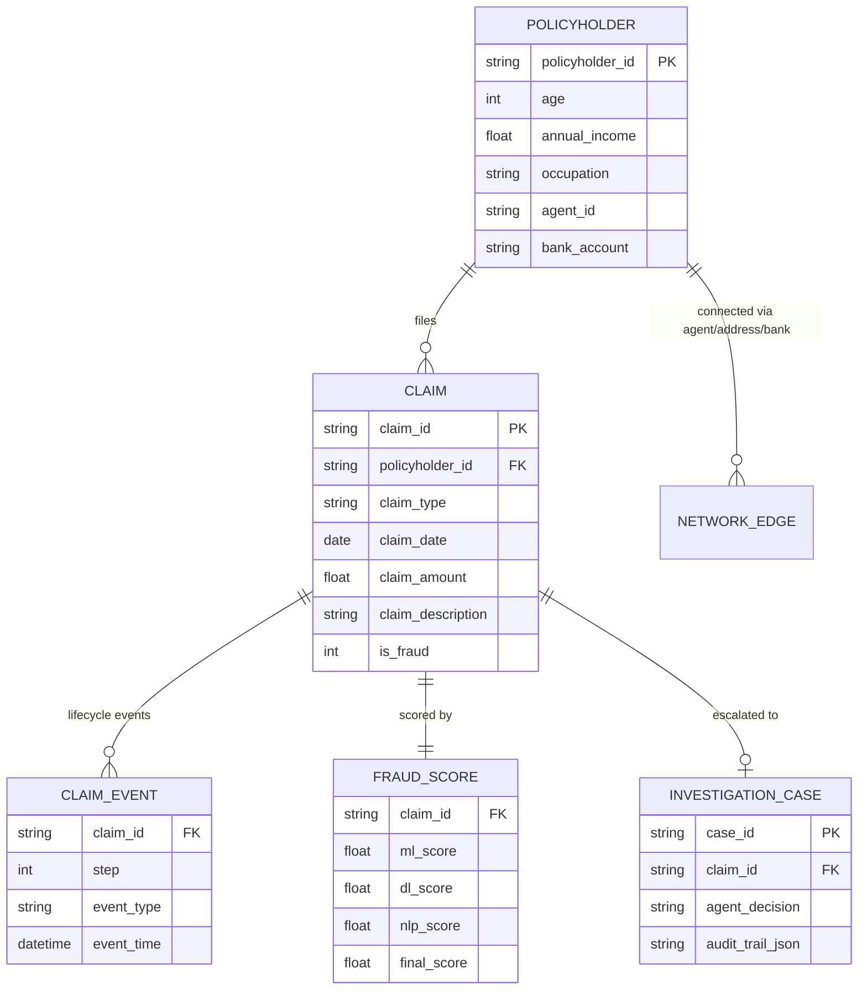

# Level: LLD — Low-Level Design
## Automated Financial Fraud Detection in Insurance Claims

## 1. System Architecture (C4 — Component level)



## 2. Component Design Specifications

| Component | Responsibility | Tech |
|---|---|---|
| Claim Submission API | Validates & accepts new claims | REST, sync, p99 < 200ms |
| Stream Processor | Cleaning (see `01_ml/preprocessing.py`), feature engineering | Kafka Streams / Spark Structured Streaming |
| Feature Store | Low-latency feature lookup for scoring | Redis (online), Parquet/Delta (offline/training) |
| ML Service | Tabular baseline scoring | Random Forest (`01_ml/best_ml_model.joblib`), served via a lightweight model server |
| DL Service | Sequence (RNN) + graph-feature scoring | NumPy RNN weights (`02_dl/rnn_from_scratch.py`), graph features precomputed nightly |
| NLP Service | Text classification + NER | TF-IDF + LogisticRegression (`03_nlp/text_classifier.joblib`) |
| Score Aggregator | Weighted ensemble of ML/DL/NLP scores into one fraud probability | Simple weighted average, versioned weights |
| SLM Service | Summarizes claim + generates grounded explanation for medium-risk claims | `04_slm/slm_summarizer.py` logic, cache-backed |
| Agentic AI | Autonomous multi-step investigation for high-risk claims | `07_agentic_ai/agent.py` — perceive → reason → plan → act loop |
| GenAI Service | Generates synthetic fraud patterns to augment rare-class training data | `06_genai/genai_synthetic.py`, offline batch job |

## 3. API Contracts (OpenAPI-style summary)

### POST /v1/claims
```json
Request:
{
  "policyholder_id": "PH11413",
  "claim_type": "Auto",
  "claim_amount": 47710.50,
  "claim_description": "text...",
  "claim_date": "2025-06-01"
}
Response 202 Accepted:
{ "claim_id": "CLM503687", "status": "SCORING_IN_PROGRESS" }
```

### GET /v1/claims/{claim_id}/score
```json
Response 200:
{
  "claim_id": "CLM503687",
  "fraud_probability": 0.87,
  "component_scores": { "ml": 0.79, "dl_rnn": 0.91, "nlp_text": 0.88 },
  "decision": "ESCALATE_TO_INVESTIGATION",
  "explanation": "Investigator note: ...grounded rationale..."
}
```

### POST /v1/agent/investigate/{claim_id}
Triggers the Agentic AI workflow (see Level: Agentic AI). Returns a case report
with recommended action (`APPROVE` / `REJECT` / `ESCALATE_HUMAN`) and an audit trail
of every tool call the agent made.

## 4. Data Models



## 5. Non-Functional Requirements
- **Throughput**: system must sustain 500 claims/sec at peak (auto-renewal season)
- **Latency**: p99 scoring latency < 300ms for ML/NLP path; async for Agentic path (SLA: case report within 5 min)
- **Scalability**: Stream Processor and ML/NLP services horizontally scalable (stateless, feature store is the shared state)
- **Reliability**: at-least-once claim processing via Kafka; idempotent scoring keyed by `claim_id`
- **Security**: PII (bank_account, income) encrypted at rest; access to raw claim text audit-logged
- **Observability**: per-component score distributions monitored for drift; alert if fraud rate deviates > 2σ from rolling baseline

## 6. Deployment Strategy
- Containerized services (ML/DL/NLP/SLM/Agent) on Kubernetes, each independently scalable
- Model artifacts versioned in a model registry; canary rollout for new model versions (5% → 25% → 100% traffic)
- Feature store: Redis cluster (online), Delta Lake on object storage (offline/training)
- Nightly batch job recomputes graph features (`02_dl/graph_features.py`) and retrains on GenAI-augmented data

## 7. Common Mistakes Avoided
- Non-functional requirements (throughput/latency/security) specified up front, not as an afterthought
- Idempotency key (`claim_id`) prevents duplicate scoring under Kafka at-least-once delivery
- Explanation service is grounded-template based specifically to avoid unauditable free-form generation reaching investigators
